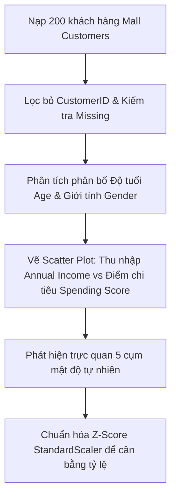
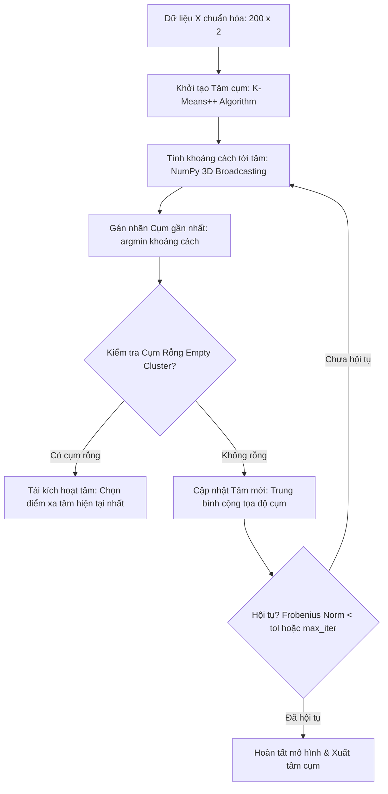
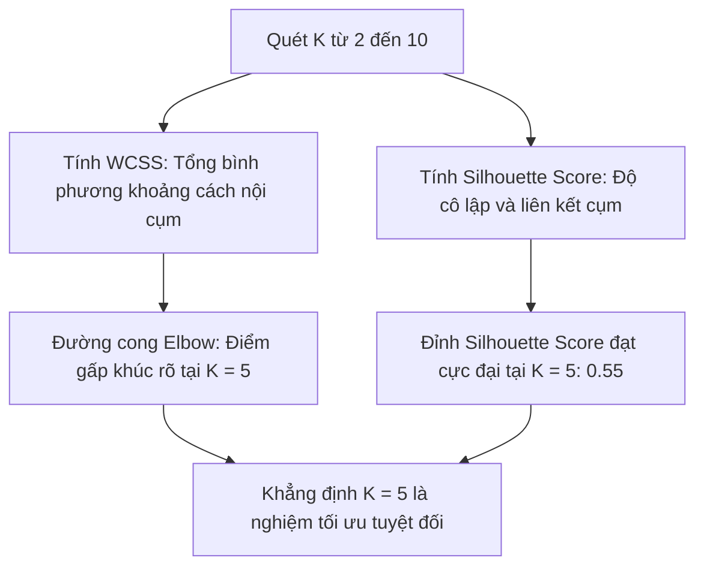
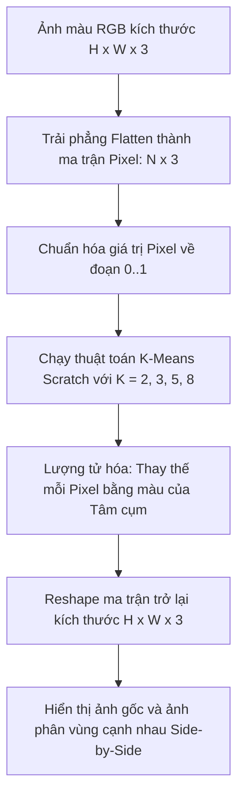

# LAB 3: PHÂN CỤM K-MEANS & NÉN ẢNH 
---

## 1. TỔNG QUAN OUTPUT (KẾT QUẢ ĐẦU RA)

### Output của bài toán này là gì?
1. **Phân khúc khách hàng (Customer Segmentation):**
   - **Định dạng:** Mã phân cụm số nguyên $0, 1, 2, 3, 4$ kèm theo tên chân dung khách hàng (*Customer Persona*), ví dụ: `VIP / High Spender` hoặc `Sensible / Saver`.
   - **Độ đo phụ:** Khoảng cách Euclid từ điểm dữ liệu đến tâm cụm gần nhất biểu thị mức độ điển hình của khách hàng trong nhóm.
2. **Phân vùng ảnh màu (Image Segmentation - Bài tập bổ sung):**
   - **Định dạng:** Bức ảnh tái tạo sau khi lượng tử hóa màu sắc (*Color Quantization*) với $K$ dải màu chủ đạo, giảm kích thước lưu trữ và cô lập các vùng trực quan.
- **Lưu trữ ở đâu?**
  - Dữ liệu sạch sau tiền xử lý: `data/processed/mall_customers_cleaned.csv`
  - Tâm cụm $K=5$ và siêu tham số xuất xưởng: `models/kmeans_model.json`
  - Báo cáo phân cụm và kết quả nén ảnh: `reports/evaluation_results.md`, `reports/demo_results.md` và `reports/image_segmentation_report.md`
  - Các hình ảnh trực quan hóa: `outputs/figures/elbow_silhouette.png`, `cluster_visualization.png`, `image_segmentation_comparison.png`

---

## 2. QUY TRÌNH PHÂN TÍCH KHÁM PHÁ (EDA) & CHỌN LỌC ĐẶC TRƯNG



### Chi tiết các bước và Giải thích Code
- **Tại sao lại chọn cặp đặc trưng `Annual Income` và `Spending Score`?**
  Khi vẽ ma trận phân tán (Pairplot) trên 200 khách hàng:
  - Cặp `Age` vs `Spending Score` tạo ra một đám mây điểm mờ nhạt không có biên giới rõ ràng.
  - Cặp `Annual Income` (Thu nhập hàng năm) vs `Spending Score` (Điểm chi tiêu do trung tâm thương mại chấm điểm từ 1-100) tạo thành **5 hòn đảo dữ liệu tách biệt cực kỳ hoàn hảo**. Đây là cặp đặc trưng có giá trị phân khúc thương mại cao nhất.
- **Tại sao bắt buộc phải Chuẩn hóa (Feature Scaling)?**
  `Annual Income` tính bằng nghìn USD ($15k \sim 137k$), trong khi `Spending Score` chỉ từ $1 \sim 99$. Khoảng cách Euclid bị phụ thuộc nặng nề vào đơn vị đo. Nếu không chuẩn hóa, trục thu nhập sẽ lấn át hoàn toàn trục điểm chi tiêu trong việc tính khoảng cách.

---

## 3. THUẬT TOÁN K-MEANS++ & TĂNG TỐC BROADCASTING 100% SCRATCH



### Chi tiết các bước và Giải thích Code
1. **Thuật toán Khởi tạo K-Means++ (Chống bẫy cực tiểu địa phương):**
   - Khởi tạo ngẫu nhiên truyền thống rất dễ chọn 2 tâm cụm nằm sát nhau, khiến thuật toán hội tụ vào kết quả tồi.
   - K-Means++ chọn tâm đầu tiên ngẫu nhiên. Các tâm tiếp theo được chọn với xác suất tỷ lệ thuận với bình phương khoảng cách đến tâm gần nhất:
     $$P(x) = \frac{D(x)^2}{\sum_{x'} D(x')^2}$$
   - Giúp các tâm cụm ban đầu tản ra xa nhau nhất có thể, được chứng minh toán học giúp cải thiện tốc độ hội tụ và giảm sai số WCSS tới $O(\log K)$ lần.
2. **Kỹ thuật Tính khoảng cách Siêu tốc bằng 3D NumPy Broadcasting (Không dùng vòng lặp For):**
   ```python
   # X shape: (N, 2), Centroids shape: (K, 2)
   diff = X[:, np.newaxis, :] - centroids[np.newaxis, :, :]  # Shape: (N, K, 2)
   distances = np.sqrt(np.sum(diff ** 2, axis=-1))          # Shape: (N, K)
   labels = np.argmin(distances, axis=1)                    # Shape: (N,)
   ```
   *Tại sao lại viết như vậy?* Thay vì lặp qua từng khách hàng và từng cụm bằng Python thuần (cực chậm khi xử lý hàng triệu pixel ảnh), Broadcasting tận dụng vector hóa C-level của NumPy, tăng tốc độ xử lý lên gấp hàng chục lần.
3. **Cơ chế Xử lý Cụm Rỗng (Empty Cluster Re-seeding):**
   Nếu trong quá trình lặp một cụm không nhận được mẫu nào, việc chia cho số lượng phần tử sẽ gây lỗi `NaN` ($0/0$). Code lập tức phát hiện cụm rỗng và tái gán tâm đó vào điểm dữ liệu có sai số lớn nhất hiện tại.

---

## 4. XÁC ĐỊNH SỐ CỤM TỐI ƯU & GIẢI MÃ 5 CHÂN DUNG KHÁCH HÀNG



### 5 Chân dung Khách hàng Thực tế (Customer Personas):
1. **Cluster 0 - Nhóm Phổ thông (Standard / Average):** Thu nhập trung bình ($40k - $70k), mức chi tiêu vừa phải ($40 - $60 điểm). Chiếm số lượng đông nhất.
2. **Cluster 1 - Nhóm Khách hàng VIP (High Income, High Spending) 🌟:** Thu nhập khủng (> $70k), chi tiêu rất mạnh tay (> $65 điểm). Đây là nguồn doanh thu vàng của trung tâm thương mại, cần phục vụ theo chế độ chăm sóc khách hàng đặc quyền.
3. **Cluster 2 - Nhóm Khách hàng Chịu chơi (Careless / Spenders):** Thu nhập khiêm tốn (< $40k) nhưng mức độ vung tay chi tiêu cực kỳ cao (> $60 điểm). Thường là giới trẻ, tín đồ thời trang chạy theo xu hướng.
4. **Cluster 3 - Nhóm Thận trọng / Tiết kiệm (Sensible / Savers):** Thu nhập rất cao (> $70k) nhưng chi tiêu rất dè xẻn (< $40 điểm). Nhóm này khó tính nhưng nhiều tiềm năng; chiến lược tiếp thị cần nhấn mạnh vào chất lượng bền vững và các chương trình ưu đãi tích điểm lớn.
5. **Cluster 4 - Nhóm Tiết kiệm Bắt buộc (Budget / Conservative):** Thu nhập thấp (< $40k) và chi tiêu thấp (< $40 điểm). Chỉ mua sắm các nhu yếu phẩm cơ bản khi thật sự cần thiết.

---

## 5. BÀI TẬP BỔ SUNG: PHÂN VÙNG ẢNH MÀU (IMAGE SEGMENTATION)



### Ý nghĩa Kỹ thuật và Ứng dụng:
- **Nguyên lý:** Mỗi điểm ảnh (pixel) là một vector 3 chiều $[R, G, B]$. Một bức ảnh kích thước $300 \times 400$ tương đương với $120.000$ điểm dữ liệu trong không gian màu 3D.
- **Kết quả thực nghiệm:**
  - $K = 2$: Phân tách ảnh thành 2 mảng màu nhị phân tương phản (dùng tách nền/foreground).
  - $K = 5$: Giữ được màu xanh của lá cây, màu nâu của đất đá và màu xanh của bầu trời, nhưng loại bỏ các biến thể ánh sáng phức tạp.
  - $K = 8$: Bức ảnh gần như giữ nguyên vẹn cảm nhận thị giác của mắt người nhưng số lượng màu độc nhất giảm từ hơn $60.000$ màu xuống chỉ còn đúng $8$ màu (nén dữ liệu ảnh mạnh mẽ).

---

## 6. BỘ CÂU HỎI VẤN ĐÁP BẢO VỆ ĐỒ ÁN (VIVA FAQS)

- **Câu hỏi 1: Tại sao K-Means++ lại được coi là tiêu chuẩn vàng thay vì K-Means ngẫu nhiên?**
  *Trả lời:* K-Means ngẫu nhiên có xác suất rất cao rơi vào điểm hội tụ kém (Local Minima) nếu ngẫu nhiên chọn các tâm cụm gần nhau. K-Means++ sử dụng phân phối xác suất tỷ lệ với khoảng cách bình phương $D(x)^2$, đẩy các tâm ban đầu trải đều khắp không gian dữ liệu, giúp thuật toán hội tụ nhanh hơn gấp nhiều lần và kết quả ổn định qua các lần chạy.
- **Câu hỏi 2: Silhouette Score hoạt động như thế nào và giá trị của nó thể hiện điều gì?**
  *Trả lời:* Với mỗi điểm $i$, công thức là $s(i) = \frac{b(i) - a(i)}{\max(a(i), b(i))}$, trong đó $a(i)$ là khoảng cách trung bình tới các điểm cùng cụm (độ gắn kết), và $b(i)$ là khoảng cách trung bình tới cụm gần nhất tiếp theo (độ tách biệt). Giá trị dao động từ $-1$ đến $+1$. Giá trị dương cao ($\approx 0.55$ tại $K=5$) chứng minh các cụm được phân chia rất chặt chẽ và tách rời nhau rõ rệt.
- **Câu hỏi 3: Điểm giống nhau cốt lõi giữa Phân khúc Khách hàng và Phân vùng Ảnh là gì?**
  *Trả lời:* Cả hai đều biến bài toán thực tế thành bài toán gom cụm các vector trong không gian Euclid đa chiều:
  - Phân khúc khách hàng: gom các vector 2 chiều $[\text{Thu nhập}, \text{Điểm chi tiêu}]$.
  - Phân vùng ảnh: gom các vector 3 chiều $[\text{Red}, \text{Green}, \text{Blue}]$.
  Thuật toán K-Means hoàn toàn không phân biệt đối tượng là người hay điểm ảnh, nó chỉ tối ưu hóa việc giảm thiểu tổng khoảng cách bình phương nội cụm (WCSS).

