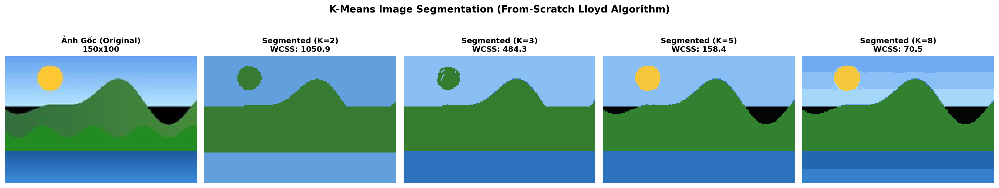

# BÁO CÁO PHÂN ĐOẠN ẢNH BẰNG K-MEANS (IMAGE SEGMENTATION)

- **Đường dẫn ảnh:** `D:\Năm 3\Máy học\ML_Lab\Lab3_KMeans_Clustering\data\raw\nature_landscape.jpg`
- **Kích thước xử lý:** `150 x 100` (15000 pixels)
- **Không gian màu:** RGB (3 đặc trưng: Red, Green, Blue)

| Số Cụm Màu (K) | Inertia (WCSS) | Tỷ Lệ Nén Màu | Nhận Xét |
|---|---|---|---|
| **K = 2** | 1050.89 | Nén về 2 màu | Tách biệt các vùng màu chủ đạo |
| **K = 3** | 484.26 | Nén về 3 màu | Tách biệt các vùng màu chủ đạo |
| **K = 5** | 158.41 | Nén về 5 màu | Tách biệt các vùng màu chủ đạo |
| **K = 8** | 70.46 | Nén về 8 màu | Tách biệt các vùng màu chủ đạo |

